<p>
  <a href="https://komarev.com/ghpvc/?username=Epic-Life&color=red">
    
  </a>
</p>

<h2> Hi, I'm Epic </h2>

I like building AI Agents and dev tools!

<p>
Although I am pro in coding , 
what I mean is I love to learn new things
but I can create crazy projects for you also 
if I like them , although there are some of 
my projects down here , I hope you like it and 
if yes then you can like it also 😏


```ts
const shauryaditya = {
  pronouns: ["he", "him"],

  languages: [Java, C++, JavaScript, Python, SQL],

  techCommunities: ["Scaler School of Technology", "Hackathons"],

  architecture: [
    "full-stack applications","REST APIs", "authentication systems",
    "database-driven applications","developer tools"
  ],

  tools: [
    React, Node.js, Express.js, MongoDB, MySQL,
    Git, GitHub, JWT, Linux, Vercel
  ],

  interests: [
    "low-level systems","backend engineering", "DSA",
    "operating systems", "cybersecurity"
  ],

  goals: [
    "build impactful open-source tools", "explore systems programming",
    "solve challenging engineering problems", "become a better software engineer"
  ]
};
```

<picture>
  <source media="(prefers-color-scheme: dark)" srcset="https://raw.githubusercontent.com/Epic-Life/Epic-Life/output/pacman-contribution-graph-dark.svg">
  <source media="(prefers-color-scheme: light)" srcset="https://raw.githubusercontent.com/Epic-Life/Epic-Life/output/pacman-contribution-graph.svg">
  
</picture>
